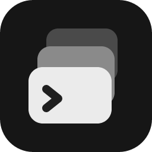
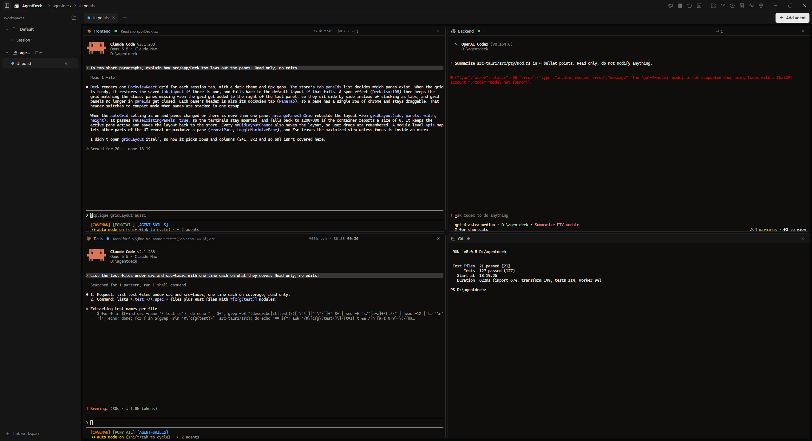
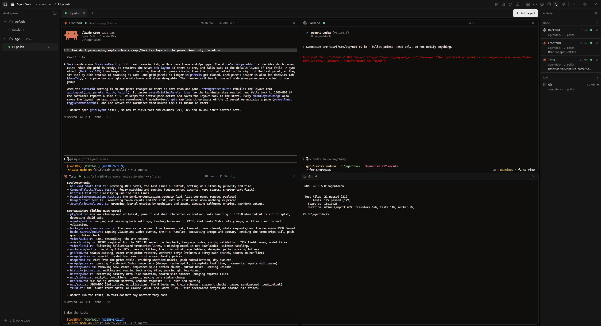
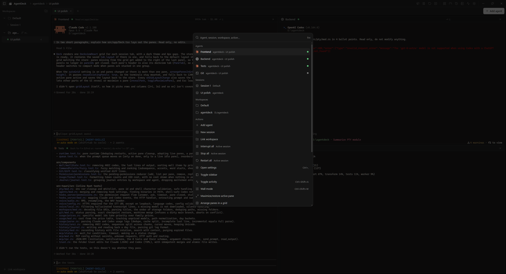
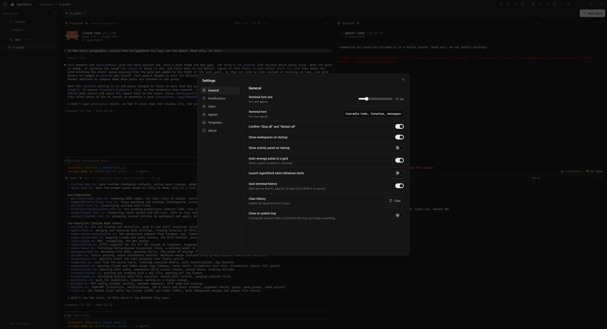

<p align="center">
  
</p>

<h1 align="center">AgentDeck</h1>

<p align="center">
  A desktop dashboard to run Claude Code, Codex, Gemini CLI and Grok Build side by side,
  see what each one is doing, and talk to them with your voice.
</p>

<p align="center">
  <a href="https://github.com/0XLUC4/AgentDeck/releases/latest">Download for Windows</a>
</p>



## Why

Running several coding agents at once usually means juggling terminal windows and checking each one to
see if it's done or waiting for you. AgentDeck puts them all in one window, arranges them in a grid and
tells you which one needs you.

## Features

**Agents and terminals**
- Real terminals (ConPTY on Windows) for Claude Code, Codex, Gemini CLI, Grok Build or a plain shell
- Panes arrange themselves in a grid (2 side by side, 3 as 2 + 1, 4 as 2x2, 6 as 3x2...)
- Zoom, maximize, detach a pane into its own window, restart, interrupt
- Optional git worktree per agent so they don't step on each other

**Know what's going on**
- Live status for every agent (working, waiting for you, done, error) through the agents' own hooks
- Activity panel across all workspaces, with the prompt, the actions taken and the final answer of each task
- Answer Claude Code permission prompts from the panel without switching windows, or let AgentDeck
  auto-allow the ones you trust in a folder ("Bash(pnpm test *)", chained commands never match)
- Desktop notifications and a sound when an agent finishes or needs you, also on your phone (ntfy or any webhook)
- Daily and per-agent cost limits that warn you, and can stop the agents
- Token and cost estimates per agent, terminal history with search, a daily journal you can export

**Workspaces and sessions**
- Link a folder, a git repo or a project already open in VS Code / Cursor / Explorer
- Several sessions per workspace, archived and reopened with their layout
- Session templates, a prompt queue per agent, broadcast one prompt to many agents
- Git panel: diff, commit, merge a worktree back or open a pull request (GitHub CLI), compare two agents,
  restore points taken before each task
- Auto review: when an agent finishes, another one reviews its changes

**Voice**
- Push-to-talk (Ctrl+Space) with a floating pill
- Offline transcription with whisper.cpp, or any OpenAI-compatible API
- Say "Codex, run the tests" to send it to a specific agent

**And**
- Command palette (Ctrl+K), wall view of every agent, orchestrator agent that can drive the others over MCP
- Browser button on a Claude pane: the agent gets its own Chrome window (Playwright MCP, separate profile) to open pages, click and fill forms
  (spawn, prompt, wait, read diffs, undo a task, merge worktrees, close agents)
- System tray, launch at startup, signed auto-updates

| Activity | Command palette | Settings |
| --- | --- | --- |
|  |  |  |

## Install

Grab the latest `AgentDeck_x.y.z_x64-setup.exe` from the [releases page](https://github.com/0XLUC4/AgentDeck/releases/latest).
It installs for your user only, no admin rights needed. Windows SmartScreen may warn the first time because
the installer isn't code-signed yet: click "More info" then "Run anyway".

You need at least one agent CLI on your PATH:
[Claude Code](https://code.claude.com/docs/en/setup),
[Codex](https://github.com/openai/codex),
[Gemini CLI](https://github.com/google-gemini/gemini-cli) or
Grok Build.

## Shortcuts

| Keys | Action |
| --- | --- |
| Ctrl+K | Command palette |
| Ctrl+Space | Hold to talk |
| Ctrl+Shift+A | Activity panel |
| Ctrl+Shift+B | Broadcast a prompt |
| Ctrl+Shift+F | Search terminal history |
| Ctrl+Shift+W | Wall view |
| Ctrl+, | Settings |
| Ctrl+= / Ctrl+- / Ctrl+0 | Zoom the focused terminal |

## Build from source

Requirements: Node 20+, pnpm, Rust (stable, MSVC on Windows), and LLVM + CMake for whisper.cpp.

```sh
pnpm install
pnpm tauri dev      # run in development
pnpm tauri build    # build the installers
```

Tests and checks:

```sh
pnpm test && pnpm lint
cd src-tauri && cargo test && cargo clippy --all-targets
```

Built with Tauri 2, Rust, React, xterm.js and dockview. Releases are described in [docs/RELEASE.md](docs/RELEASE.md).

## Privacy

Everything runs on your machine. The hook server only listens on 127.0.0.1 with a per-run token, voice
transcription is local by default, and terminal history stays in your app data folder (you can turn it off).
