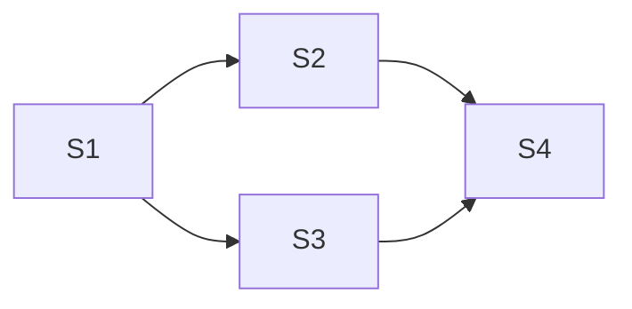
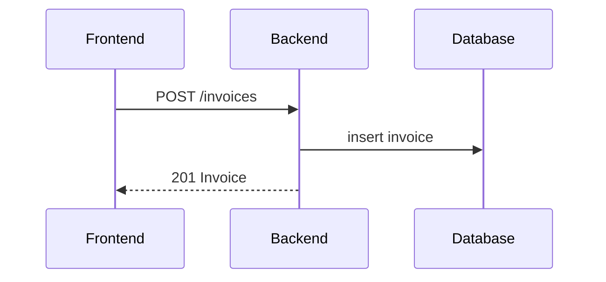

# Plan templates

Copy, fill, delete what does not apply. `<...>` is to replace; the checker reports any left over.
Paths below are as seen from each file's own folder.

## README.md (index)

~~~markdown
# <Plan title>

> Goal: <one sentence: what changes for the user>
> Done when: <exact check>
> Status: draft | approved | in progress | done — updated <yyyy-mm-dd>

**Non-goals:** <what this plan will not do>

## Map

| Area | Files |
|------|-------|
| Architecture | [architecture.md](architecture.md) · [decisions.md](decisions.md) · [risks.md](risks.md) |
| Data | [data.md](data.md) |
| Backend | [Invoices](backend/invoices.md) · [Payments](backend/payments.md) |
| Frontend | [Invoice list](frontend/invoice-list.md) · [Checkout](frontend/checkout.md) |
| Features | [F1 Send an invoice](features/f1-send-invoice.md) · [F2 Pay online](features/f2-pay-online.md) |
| Work | [files.md](files.md) · [steps.md](steps.md) |

## Features

| ID | Feature | Backend | Frontend | Data | Steps |
|----|---------|---------|----------|------|-------|
| [F1](features/f1-send-invoice.md) | Send an invoice | [invoices](backend/invoices.md) | [list](frontend/invoice-list.md) | [Invoice](data.md#invoice) | [S2](steps.md#s2), [S4](steps.md#s4) |

## Steps

| ID | Step | Status | Depends on | Parallel group |
|----|------|--------|------------|----------------|
| [S1](steps.md#s1) | Invoice table and types | todo | — | — |
| [S2](steps.md#s2) | POST /invoices | todo | S1 | A |
| [S3](steps.md#s3) | Payment provider client | todo | S1 | A |

~~~

## architecture.md

~~~markdown
[Plan](README.md) › Architecture

# Architecture

## Stack
<language, framework, versions, database, hosting> — see [D1](decisions.md#d1)

## Layers and boundaries
| Layer | Folder | Owns | Talks to |
|-------|--------|------|----------|
| Frontend | `web/src/` | screens, client state | Backend over HTTP only |
| Backend | `api/src/` | business rules, auth | Database, payment provider |
| Data | `api/db/` | schema, migrations | — |

## Data flow

## Conventions
<naming, errors, logging, tests, folder rules the steps must follow>
~~~

## decisions.md

~~~markdown
[Plan](README.md) › Decisions

# Decisions

## D1
**Choice:** <what was chosen>  
**Alternatives:** <option> (<why not>), <option> (<why not>)  
**Why:** <reason tied to the goal or a constraint>  
**Affects:** [architecture.md](architecture.md), [S1](steps.md#s1)
~~~

## data.md

~~~markdown
[Plan](README.md) › Data

# Data

## Invoice
Used by: [F1](features/f1-send-invoice.md), [backend/invoices.md](backend/invoices.md)

| Field | Type | Rules |
|-------|------|-------|
| id | uuid | primary key |
| customer_id | uuid | → [Customer](#customer), required |
| total_cents | integer | ≥ 0 |
| status | enum draft, sent, paid | default draft |

Migration: <file path>, created in [S1](steps.md#s1). Existing rows: <how they are handled>.
~~~

## backend/<area>.md

~~~markdown
[Plan](../README.md) › Backend › Invoices

# Backend: Invoices
Used by: [F1](../features/f1-send-invoice.md) · Data: [Invoice](../data.md#invoice)
Files: `api/src/invoices/routes.ts`, `api/src/invoices/service.ts` — see [files.md](../files.md)

## POST /invoices
Auth: signed-in user, owner of the customer.  
Input: `{ customerId: string, lines: { label: string, cents: number }[] }`  
Output 201: `Invoice` ([data](../data.md#invoice))  
Errors: 400 invalid lines, 404 unknown customer, 403 not owner.  
Called by: [frontend/invoice-list.md](../frontend/invoice-list.md#new-invoice-form)  
Built in: [S2](../steps.md#s2)
~~~

## frontend/<area>.md

~~~markdown
[Plan](../README.md) › Frontend › Invoice list

# Frontend: Invoice list
Used by: [F1](../features/f1-send-invoice.md) · Route: `/invoices`
Files: `web/src/routes/invoices.tsx`, `web/src/components/InvoiceForm.tsx` — see [files.md](../files.md)

## New invoice form
Fields and validation: <list>.  
Calls: [POST /invoices](../backend/invoices.md#post-invoices).  
States: loading, empty, error (<message per backend error>), success.  
Built in: [S4](../steps.md#s4)
~~~

## features/<id>-<name>.md

~~~markdown
[Plan](../README.md) › Features › F1

# F1 Send an invoice

**Story:** As <user>, I want <action> so that <benefit>.

## Acceptance criteria
- [ ] <observable behaviour, testable>
- [ ] <error case and what the user sees>

## Parts
| Layer | Where |
|-------|-------|
| Data | [Invoice](../data.md#invoice) |
| Backend | [POST /invoices](../backend/invoices.md#post-invoices) |
| Frontend | [New invoice form](../frontend/invoice-list.md#new-invoice-form) |
| Steps | [S1](../steps.md#s1), [S2](../steps.md#s2), [S4](../steps.md#s4) |
~~~

## files.md

~~~markdown
[Plan](README.md) › Files

# Files

| File | Action | Layer | Feature | Step |
|------|--------|-------|---------|------|
| `api/db/migrations/003_invoices.sql` | create | data | [F1](features/f1-send-invoice.md) | [S1](steps.md#s1) |
| `api/src/invoices/routes.ts` | create | backend | [F1](features/f1-send-invoice.md) | [S2](steps.md#s2) |
| `web/src/routes/invoices.tsx` | change | frontend | [F1](features/f1-send-invoice.md) | [S4](steps.md#s4) |
~~~

## steps.md

~~~markdown
[Plan](README.md) › Steps

# Steps

## S1
**Invoice table and types** — status: todo  
For: [F1](features/f1-send-invoice.md) · Data: [Invoice](data.md#invoice)  
Files: `api/db/migrations/003_invoices.sql`, `api/src/invoices/types.ts`  
Do not touch: `web/`  
Depends on: —  · Parallel group: —  
Check: `pnpm test api/db` passes and `pnpm db:migrate` applies 003 on a fresh database.
~~~

## risks.md

~~~markdown
[Plan](README.md) › Risks

# Risks

## R1
**Risk:** <what could go wrong>  
**Notice:** <the signal: failing check, metric, error>  
**Response:** <what you will do>  
**Affects:** [S3](steps.md#s3)
~~~

## PLAN.md (medium work, single file)

The README.md template's goal block and step table, then the steps.md entries, then a short Risks
list, all in one file. Same rules: exact checks, stable IDs, no placeholders.
